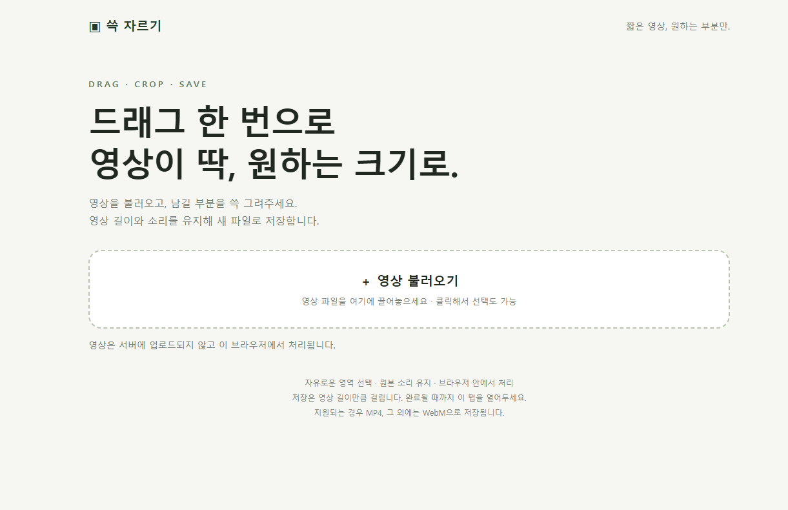

# DRAG · CROP · SAVE

### 쓱 자르기 — 짧은 영상, 원하는 부분만.

**영상 하나 자르려고 편집 프로그램까지 켤 필요는 없으니까.**

파일을 불러오고, 남길 부분을 드래그하고, 저장하세요. 설치도, 로그인도, 서버 업로드도 없이 내 컴퓨터의 브라우저에서 영상 화면을 자유롭게 잘라냅니다.



## 바로 사용하기

1. 저장소 위쪽 **Code → Download ZIP**으로 파일을 받습니다.
2. ZIP 압축을 풀고 **`영상 크롭.html`**을 Chrome 또는 Edge에서 엽니다.
3. 영상 파일을 끌어놓거나 **영상 불러오기**를 누릅니다.
4. 영상에서 남기고 싶은 영역을 **마우스로 드래그**합니다.
5. **잘라서 저장 ↓**을 누르면 새 동영상 파일이 다운로드됩니다.

`영상 크롭.html` 하나만 바탕화면에 두고 사용해도 됩니다. `index.html`도 동일한 기능을 제공합니다. 실행할 때 인터넷이나 Node.js 설치는 필요하지 않습니다.

## 필요한 기능만, 가볍게

| 기능 | 이렇게 사용하세요 |
| --- | --- |
| 자유로운 크롭 | 고정 비율 없이 남길 부분을 드래그 |
| 드래그 앤 드롭 | 영상 파일을 페이지에 끌어놓아 바로 불러오기 |
| 재생과 탐색 | 재생 버튼과 타임라인으로 장면 확인 |
| 볼륨 조절 | 재생 버튼 옆 슬라이더로 미리듣기 음량 조절 · 맨 왼쪽은 음소거 |
| 조용한 저장 | 저장 중에는 소리를 듣지 않아도 결과 파일에는 원본 소리가 포함 |
| 다시 선택 | 다른 영역을 다시 드래그하거나 `Esc` / 전체 영역으로 초기화 |
| 결과 확인 | 저장 후 잘린 영상 미리보기와 다시 다운로드 |
| 내 컴퓨터에서 처리 | 영상 파일을 외부 서버에 업로드하지 않음 |

> **불러오기 → 드래그 → 저장.** 프리미어를 켜지 않고 끝내는 작은 영상 작업.

## 알아두면 좋아요

- **20초 내외의 짧은 영상**에 적합합니다. 더 긴 영상을 강제로 제한하지는 않습니다.
- 영상의 **화면 영역**을 잘라내는 도구입니다. 영상 길이를 자르는 타임라인 편집 기능은 없습니다.
- 저장은 재생하면서 처리하므로 **영상 길이만큼 시간이 걸립니다**. 완료될 때까지 이 탭을 열어두세요. 다른 탭으로 이동하면 저장을 중단합니다.
- 브라우저가 지원하면 **MP4**, 그렇지 않으면 **WebM**으로 저장합니다. 입력 파일도 브라우저에서 재생 가능한 형식이어야 합니다.
- 새 파일로 재인코딩하므로 원본과 화질·파일 크기·프레임 타이밍이 완전히 동일하지는 않습니다. 인코딩 호환성을 위해 선택 영역의 가로·세로가 최대 1픽셀 줄어들 수 있습니다.
- 볼륨 슬라이더는 **미리듣기 전용**입니다. 저장 파일의 음량을 변경하지 않습니다.
- 처리는 내 컴퓨터에서 이루어지지만 **특정 그래픽카드 사용을 강제하지는 않습니다**. CPU/GPU 사용은 브라우저와 하드웨어 지원에 따라 달라집니다.

## 소스 수정하기

외부 라이브러리 없이 HTML, CSS, JavaScript로 구성했습니다.

```text
영상 크롭.html      독립 실행 파일
index.html          동일한 기능의 독립 실행 파일
dist/index.html     페이지 원본
dist/style.css      스타일
dist/app.js         파일 불러오기 · 영역 선택 · 소리 · 저장
build.cjs           독립 HTML 생성
check.cjs           기능 로직 검증
docs/screenshot.png 사용자 제공 실행 화면
```

소스를 수정한 뒤 Node.js가 설치된 환경에서 실행합니다.

```sh
node --check dist/app.js
node check.cjs
node build.cjs
```

드래그 좌표 변환, 영역 경계, 역방향 드래그, 볼륨 조절, 저장 중 음소거, 볼륨 복원, 드롭 파일 검증을 자동 확인합니다. 실제 영상의 재생·저장 결과는 사용하는 브라우저와 파일로 확인해주세요.
